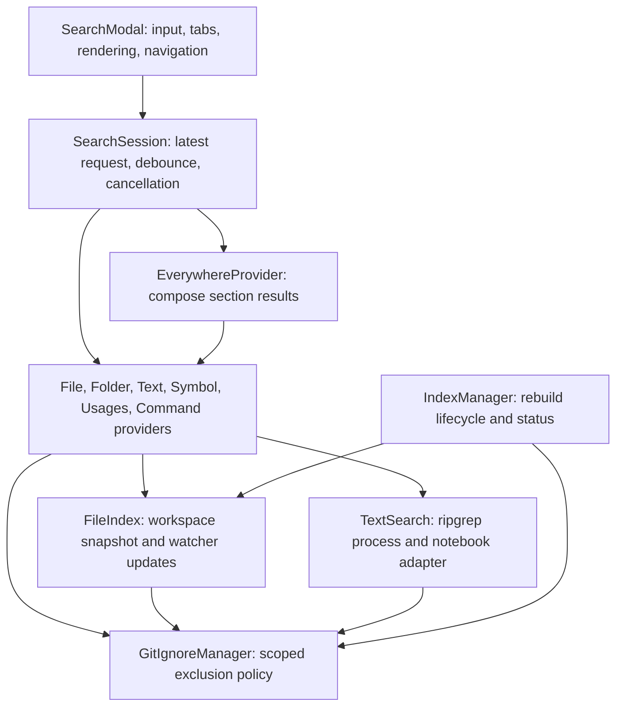

# Search architecture

search++ runs inside the VS Code extension host and presents results through the
native QuickPick interface. It indexes workspace paths in memory and searches file
contents on demand. The UI, request coordinator, providers, and workspace services
have separate responsibilities so changes to the input or index can be handled
without mixing results from different searches.

## Components

[Activation](src/extension.ts) creates the workspace services, history, providers,
and modal, then registers their disposables with VS Code. The
[provider factory](src/providers/createProviders.ts) supplies the modal with a
registry of providers that share the same search contract.

| Component | Responsibility |
| --- | --- |
| `SearchModal` | Read input and options, select a provider, render results, and navigate to the selected resource. |
| `SearchSession` | Own the current request, its debounce timer, cancellation, and delivery of current results and errors. |
| Search providers | Implement files, folders, text, symbols, usages, or commands through the `SearchProvider` contract. |
| `EverywhereProvider` | Combine enabled providers into the Everything tab's ordered sections. |
| `IndexManager` | Coordinate rebuilds, own workspace services, and report index status. |
| `FileIndex` | Store candidate paths, perform path matching, and reconcile filesystem events with the index. |
| `GitIgnoreManager` | Load and evaluate workspace exclusion rules in their directory and workspace scope. |
| `TextSearch` | Manage ripgrep processes, decode streamed matches, and search notebook cell source. |
| `ResultPreview` | Serialize background previews and manage one replaceable editor tab. |
| `SearchHistory` | Persist recent files and locations in workspace state. |

## Request lifecycle

A provider receives a query and search options, delivers result snapshots through
a callback, and returns a disposable that cancels its request. Providers can also
report errors through a separate callback. This lets the UI distinguish an empty
search from a failed search.

[SearchSession](src/searchSession.ts) cancels the previous request before starting
or scheduling another one. Each request captures a version number; its callbacks
can update the UI only while that version is current. The same guard covers
asynchronous absolute-path lookups. Starting a query clears old actionable rows. Selection, preview, usage lookup,
and result-button actions are checked against the current displayed items.
Informational rows cannot navigate like More Results rows. Clearing the input or
closing the modal cancels active work and any pending debounce timer.

File and folder searches use the same index matcher during startup and normal
operation. They wait for the first usable snapshot when necessary. Text, symbol,
usage, and command searches use the configured debounce delay. Usages are a
nested view of Symbols rather than a separate top-level tab. Enter opens a
symbol; Ctrl+Enter or Shift+F12 resolves its references. The parent search is
snapshotted before the drill-down. Back cancels references and restores the
query, displayed results, active item, and options; programmatic input changes
do not restart that restored search.
The Everything tab combines providers incrementally: files and folders use the
index, text results stream, and symbols and commands start after their debounce
delay. Section errors appear alongside results from the other providers.

`searchPlusPlus.maxResults` limits results returned by each provider. The
Everything tab applies its own section order and display limit to those results,
with a link to the individual tab when more results are available.

The popup's cog opens VS Code's normal Settings page filtered to search++.
Its settings are grouped into Search window (including shortcut presets) and
Search results; VS Code manages their User and Workspace scopes.
`getSearchConfiguration` resolves shared search-type checkboxes, one order,
the Everything-tab switch, and the opening choice in scope order. Both the modal
and `EverywhereProvider` consume this model. Unchecked types have no normal tab
or Everything provider request. Direct mode commands can temporarily open another
type without changing these preferences. Unavailable or unsaved opening choices
fall back to the first available tab.

The Search Order description links to a native QuickPick editor with per-row
up/down buttons and permanent toolbar arrows for the selected row.
`SearchOrderPicker` serializes edits at the selected User or
Workspace scope, reads the current order before each move, and retains the moved
row's selection. The standard Settings editor stays open underneath it.

Activation plans migration of the older preferences for all scopes before making
changes, saves their shared replacements, and only then removes old values.
The compatibility reader remains available after failed writes. A configuration
listener restores the previous checkbox choice if the last search is unchecked;
it also protects workspaces whose remaining type was inherited from User settings.
The reader retains a usable type for invalid configurations while that correction
is pending.

## Result previews

Cmd+Right on macOS or Ctrl+Right on Windows/Linux previews the active resource
through `ResultPreview`, preserving
QuickPick focus and the match position. The matching text editor reveals the
selected range with `TextEditorRevealType.AtTop`, including when that range
is already visible. The controller tracks only tabs created
by preview requests. It replaces its previous clean tab before opening another,
so tab reuse works with VS Code preview editors enabled or disabled. Existing
resource tabs are reused across editor groups; pre-existing preview tabs, edited
documents, pinned tabs, and previews explicitly kept open are preserved.
The same preview operation handles eye-button actions on result and history
rows, using the clicked row rather than the active row. Plain Right Arrow keeps
its normal text-editing behavior.

Preview requests run serially and skip queued work superseded by a newer request.
Closing the popup cancels queued previews. Accepting a result waits for an
in-flight preview to settle before opening the final selection, preventing an old
preview from replacing the accepted file. Preview errors leave the popup open.
Accepting a positioned result or using Go to File also reveals the matched line
at the top of the text editor after opening it.

## Workspace discovery and exclusions

Discovery collects files across workspace roots and excludes Git's internal
metadata. The index retains candidates controlled by the Git-ignore and
search-ignore toggles so changing either toggle can reveal those paths. Custom
`searchPlusPlus.excludePaths` rules always apply. Excluded matches do not consume
the provider's result limit.

Resources are identified by their full URI. Ignore matching uses paths relative
to the URI's workspace root. Each `.gitignore` or `.searchignore` belongs to that
root and its containing directory. Rules apply from parent directories to
children, and a rule inside an ignored directory cannot re-include its files.

[GitIgnoreManager](src/gitignore.ts) publishes complete rule sets after loading
both kinds of ignore file. Concurrent callers share the load operation. Changes
to ignore files or custom exclusion settings reload the policy and trigger an
index rebuild.

## Index updates and resource ownership

[FileIndex](src/index/fileIndex.ts) publishes a complete snapshot after discovery
and keeps the previous snapshot usable during a rebuild. Its watcher records
changes while discovery is running, then reconciles those changes with the new
snapshot before publication.

Watcher updates are batched and deduplicated by URI. Creation events are checked
to distinguish files from directories. Deleting a directory removes its indexed
descendants; a batch removes all deleted directories in one pass over the index.
Ignore rules are evaluated only for created files, because rule changes rebuild
the index. Directory creation and bulk changes mark the index stale so
[IndexManager](src/index/indexManager.ts) can schedule a rescan. Rebuild requests
are serialized, and the status bar reports building, ready, stale, or error state.

The modal owns its search session and preview controller, IndexManager owns the workspace services, and
the provider factory owns the command provider's extension-change subscription.
Disposal cancels requests and builds, clears timers, stops processes, and releases
watchers and event subscriptions.

## Search backends

Files and folders support literal substring and fuzzy matching. Whole-word
matching uses the literal path, and case-sensitive matching checks the query's
case explicitly. Folder search derives and deduplicates ancestors of eligible
files before matching and applying the result limit. Absolute-path navigation
uses a filesystem lookup independently of the index.

[TextSearch](src/index/textSearch.ts) starts ripgrep for each content query and
streams its JSON output. It resolves the executable from the development package,
VS Code's bundled ripgrep, or the system PATH. Queries support literal text,
regular expressions, case sensitivity, and whole-word matching. Stream decoding
preserves UTF-8 characters across chunks, and match byte offsets are converted to
VS Code's UTF-16 editor columns.

Notebook search reads `.ipynb` cell source separately from ripgrep's file search.
The notebook list comes from the file index snapshot for the active exclusion
toggles, so a text search does not walk the workspace again.
Successful searches signal completion after the notebook stage finishes.
Selecting a notebook match opens the notebook; navigation to a specific cell is
unsupported.

Symbol search requests candidates from VS Code's workspace symbol providers, then
applies name-matching options and path exclusions before limiting results. Its
coverage depends on the installed language extensions and their indexing state.

Usages is a two-step interaction within the native popup. Without a target,
queries use the symbol provider and Enter chooses a symbol. The modal retains
its URI and position as a `UsageTarget`, shows the selected symbol name in the
input, and dispatches to `UsagesProvider`. That unchanged name is lookup context;
replacing it filters references. Clearing the input cancels the request and
clears the target and cached filters, returning to the symbol chooser. The
original symbol query and reference filter have separate state so changing modes
or choosing another symbol cannot reuse the wrong input. Closing the popup
clears that context.

The usages provider calls `vscode.executeReferenceProvider`, deduplicates returned
locations, applies exclusion rules, and reads previews from open documents. Reads
are shared within a request. Queries filter previews and paths before the result
limit, and rows set `alwaysShow` so native label filtering cannot hide path matches.
A missing preview keeps its reference navigable. Cancellation stops subsequent
reads and suppresses late callbacks. Reference locations are resolved again for
new requests; no cross-query cache retains stale positions.

Command search builds a catalog from registered commands and extension metadata;
extension changes invalidate that catalog.

## Support and performance

The extension targets VS Code 1.96 and newer compatible releases. Button locations
and toggles are enabled from VS Code 1.109, when those APIs were
[finalized](https://code.visualstudio.com/updates/v1_109#_extensions-and-api). Older
hosts use title-bar buttons with option states in tooltips. Filesystem workspaces can be searched on a remote extension host when ripgrep is available
there. Text search for virtual workspace schemes is unsupported.

The path index includes ignored candidates, so large dependency trees increase
initial indexing time and memory use. Content is searched on demand rather than
stored in a second index. Folder search includes directories represented by
eligible indexed files; empty directories do not appear.

## Validation

`npm run check` runs TypeScript checking, linting, tests, and the production build.
The native popup factory is injectable so host tests can drive actual input
changes through symbol selection, reference lookup, clearing, and a fresh query.
The tests cover workspace discovery, exclusion scope, request cancellation, index
updates, matching, process failures, Unicode handling, navigation, notebook source
extraction, symbol selection for usages, and native popup reference filtering.
Preview tests cover tab reuse, existing and edited files, rapid requests, and
accepting a final selection. Row navigation tests check the Go to File action,
line and column preservation, and history recording. History cleanup tests
protect newer opens and removals from stale asynchronous snapshots. Real ripgrep
fixtures complement deterministic lifecycle tests.
Text tests wait for completion, including the notebook stage. Test files run
serially to keep filesystem and scalability checks from competing for resources.

`npm run test:host` exercises activation, file and folder search, exclusion
toggles, real text search, real TypeScript workspace-symbol and cross-file
reference lookup, popup commands, preview tab counts and focus with both preview
settings, Go to File navigation without splitting the editor, and reindexing in an isolated VS Code
host. CI runs this smoke test on Linux against VS Code 1.96.0 and current stable,
and runs the standard checks on Linux, macOS, and Windows before packaging the
VSIX. See the [development and release procedures](README.md#development-and-validation)
for setup, commands, and publishing requirements.
