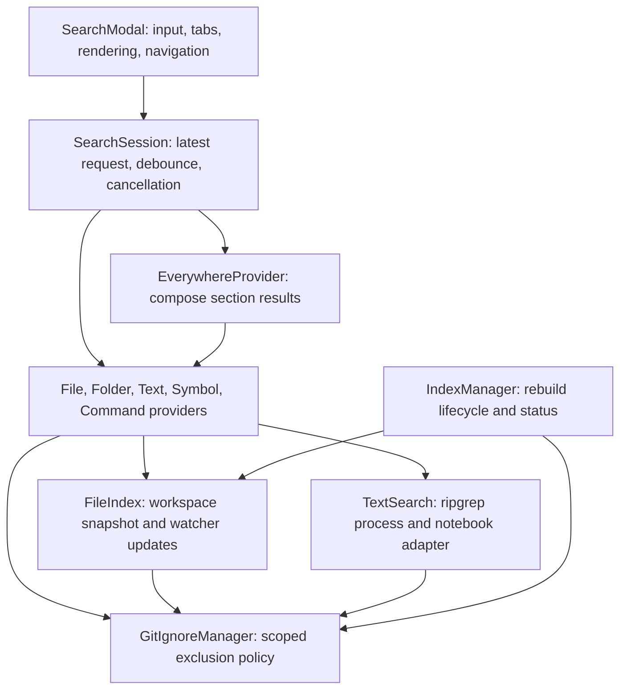

# Search architecture and reliability audit

The native QuickPick UI is a good fit for search++. The reliability problems come
from inconsistent discovery, filtering, and asynchronous request ownership. Keep
the UI and provider split; make those shared contracts explicit before adding
features or introducing another framework.

## Corrected failure modes

The implementation and regression tests address the following problems found in
the original code.

| Priority | Failure in the original implementation | Effect |
| --- | --- | --- |
| High | Discovery excludes directories collected from both ignore files, plus every `node_modules` directory. | Turning an exclusion off cannot recover files missing from the index. Negated rules cannot recover files removed during discovery either. |
| High | Startup file search interpolates user input into a glob and caps discovery before matching. | Fuzzy queries, path queries, literal glob characters, and files beyond the cap behave differently before indexing finishes. |
| High | Delayed provider callbacks, notebook reads, and absolute path lookups can outlive their query. Debounced work survives some tab and input changes. | Results for an old query can replace current results. |
| High | Ignore rules from all workspace roots share one matcher; nested basename patterns are flattened into anchored paths. | One root can hide another root's files, and nested rules can miss deeper descendants. |
| High | Ripgrep resolution checks only the older bundled package layout. The VSIX excludes the development dependency. Process errors and stderr are discarded. | Packaged text search can silently show no results when the executable is missing or a query fails. |
| Medium | Folder search first selects at most 1,000 matching files, then applies a substring filter to folders. | Valid folders disappear behind file limits; fuzzy folder queries can return nothing. |
| Medium | A rebuild clears the working index before discovery completes. Watcher updates use relative paths, append duplicates, and do not remove directory descendants. | Reindexing and file operations can produce missing, duplicate, or stale entries. |
| Medium | Fzf and ripgrep use smart case even when Match Case is off. | An uppercase query unexpectedly hides lowercase matches. |
| Medium | Ripgrep byte offsets are used as VS Code character columns. | Navigation lands at the wrong position after non-ASCII text. |
| Medium | Accepting a result hides the picker before reading its line target; hiding resets that target. | `file:line:column` navigation can lose the requested position. |
| Medium | Symbol and command provider rejections have no error handler; symbols are capped before exclusions. | Failures can remain unresolved, and ignored symbols consume the visible result budget. |
| Medium | The modal assumes a button API absent from the declared minimum VS Code version. | Opening search can throw before displaying the picker. |
| Medium | Text search omits hidden files, depends on a Git repository to apply ignore rules, and also searches notebook JSON. | Text results disagree with file results and notebook matches appear twice. |
| Medium | Streaming output uses a debounce and decodes each chunk separately. | Continuous output delays visible progress, and split Unicode characters become corrupted. |

## Implemented structure

Activation constructs providers through `createProviders`. The modal presents results and
opens resources. A request coordinator owns cancellation and publication, including
the delay before a provider starts. Providers implement one search mode; the
Everywhere provider combines their results without changing their matching rules.

Discovery keeps a complete candidate snapshot, excluding Git's internal metadata.
Toggle-controlled exclusions apply after discovery, before the visible result limit.
Resource identity is the full URI; a display path is never a cross-workspace key.
Ignore rules apply relative to their own workspace root and containing directory,
in parent-to-child order. Custom exclusions always apply.

Builds publish complete snapshots atomically and retain the previous usable
snapshot during discovery. Watcher changes are deduplicated and reconciled with
the snapshot. IndexManager serializes rebuild requests and owns status changes.
All timers, watchers, requests, and processes have an explicit disposable owner.

Text content remains streamed from ripgrep rather than stored in a second content
index. Notebook source requires a separate adapter because the file on disk is
JSON. Errors must reach the current request so a failed process is distinguishable
from a successful search with no matches.

## Scope and tradeoffs

This design keeps the extension in one process with no database, server, or new
runtime framework. File paths are inexpensive to index; content is searched on
demand. The cost of making ignore toggles truthful is discovering ignored files as
well. Very large dependency trees can therefore increase initial indexing time and
memory. Any future candidate cap must be explicit in the UI rather than silently
reported as a complete search.

Workspace symbols depend on installed language extensions and their indexing
state. Regex and fuzzy controls apply where supported by each provider; text
search uses ripgrep's regex engine. Files and folders use literal or fuzzy path
matching. Empty directories are not represented in the file-derived folder index.

Remote extension hosts with filesystem workspaces can run ripgrep on that host.
Virtual workspace schemes need a separate text-search adapter before they can be
advertised as supported. Notebook results open the notebook; navigating to the
exact matching cell remains a separate enhancement. Empty directories, precise
notebook cell navigation, and virtual-workspace text search are outside this change.

The modal falls back to title-bar buttons when the newer button location API is
unavailable. That fallback is covered with mocks matching the absence of the API
in [VS Code 1.96](https://raw.githubusercontent.com/microsoft/vscode/1.96.0/src/vscode-dts/vscode.d.ts).
Full extension-host validation uses the installed VS Code version. Linux, Windows,
and a complete VS Code 1.96 host run have not been executed locally.

## Verification

Regression tests exercise discovery through the public build path as well as
prepared in-memory entries. They cover exclusion toggles, nested and multiple-root
rules, rapid query changes, directory deletion, rebuild races, fuzzy folders,
process failures, Unicode columns and decoding, line navigation, and notebook
source extraction. Real ripgrep tests complement deterministic lifecycle tests.

`npm run check` runs TypeScript checking, linting, all Vitest tests, and the
production bundle. Branch pushes, pull requests, and version-tag releases run that
command on Linux, macOS, and Windows.
The final local run passed all 329 tests across 24 test files, type checking,
linting, and the production build.
`npm run test:host` checks activation, fuzzy files and folders, both exclusion
toggles, real text search, modal commands, and reindexing in an isolated host.
The host smoke test passed on VS Code 1.124.2 on macOS.
CI also runs downloaded VS Code 1.96.0 and current stable builds on Linux before
packaging the VSIX. Real text-search tests wait for the search completion signal
rather than fixed delays, including the notebook stage.
