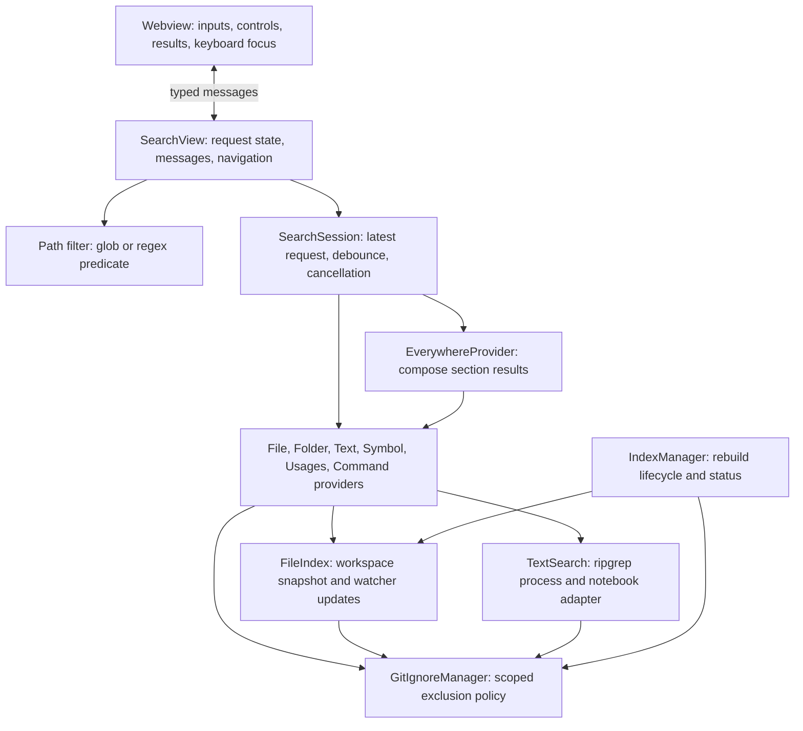

# Search architecture

search++ runs inside the VS Code extension host and presents a two-input search view
in an editor webview. It indexes workspace paths in memory and searches file
contents on demand. The UI, request coordinator, providers, and workspace services
have separate responsibilities so changes to the input or index can be handled
without mixing results from different searches.

## Components

[Activation](src/extension.ts) creates the workspace services, history, providers,
and search view, then registers their disposables with VS Code. The
[provider factory](src/providers/createProviders.ts) supplies the view with a
registry of providers that share the same search contract.

| Component | Responsibility |
| --- | --- |
| Webview renderer | Display two inputs, modes, options, and results; manage field focus and selection. |
| `SearchView` | Own query, scope, options, symbol target, and result identities; dispatch requests and navigate. |
| Path filter | Compile glob includes or a path regex into a shared resource predicate. |
| `SearchSession` | Own the current request, its debounce timer, cancellation, and delivery of current results and errors. |
| Search providers | Implement files, folders, text, symbols, usages, or commands through the `SearchProvider` contract. |
| `EverywhereProvider` | Combine enabled providers into the Everything tab's ordered sections. |
| `IndexManager` | Coordinate rebuilds, own workspace services, and report index status. |
| `FileIndex` | Store candidate paths, perform path matching, and reconcile filesystem events with the index. |
| `GitIgnoreManager` | Load and evaluate workspace exclusion rules in their directory and workspace scope. |
| `TextSearch` | Manage ripgrep processes, decode streamed matches, and search notebook cell source. |
| `SearchHistory` | Persist recent files and locations in workspace state. |

## Request lifecycle

A provider receives a query and search options, delivers result snapshots through
a callback, and returns a disposable that cancels its request. Providers can also
report errors through a separate callback. This lets the UI distinguish an empty
search from a failed search.

[SearchSession](src/searchSession.ts) cancels the previous request before starting
or scheduling another one. Each request captures a version number; its callbacks
can update the UI only while that version is current. The same guard covers
asynchronous absolute-path lookups. Clearing the input or closing the view
cancels active work and any pending debounce timer.

File and folder searches use the same index matcher during startup and normal
operation. They wait for the first usable snapshot when necessary. Text, symbol,
usage, and command searches use the configured debounce delay on their individual tabs.
The Everything tab combines providers incrementally: files and folders use the
index, text results stream, and symbols and commands start after their debounce
delay. Section errors appear alongside results from the other providers.

`searchPlusPlus.maxResults` limits results returned by each provider. The
Everything tab applies its own section order and display limit to those results,
with a link to the individual tab when more results are available.

## View boundary and path scope

The extension host retains search results and accepts result IDs for navigation,
command execution, and reference lookup. The webview sends input and control
messages. It receives display data, with provider text inserted through DOM text
nodes. A content security policy permits only local styles and fonts and a
nonce-authorized script. Webview resources are restricted to the packaged asset
directory.

Each input change has a revision. The renderer rejects snapshots for older input,
and `SearchSession` rejects callbacks from older requests. These guards cover both
sides of the asynchronous message boundary. The host clears old actionable results
when starting a new search. Keyboard context keys are enabled only while the search
view has focus, so terminal and command-palette keys retain their normal behavior.

The `in:` field compiles to a predicate over full resource URIs. Glob includes
support comma-separated alternatives, braces, implicit descendant matching, root
anchoring, and workspace names in multi-root workspaces. Regex uses normalized
workspace-relative paths. Invalid regex cancels the request and displays an error.
Providers apply scope and exclusion predicates before their result limits. Folder
scope matches derived folder URIs; text scope also filters notebooks before reads.
Commands are global.

## Workspace discovery and exclusions

Discovery collects files across workspace roots and excludes Git's internal
metadata. The index retains candidates controlled by the Git-ignore and
search-ignore toggles so changing either toggle can reveal those paths. Custom
`searchPlusPlus.excludePaths` rules always apply. Excluded matches do not consume
the provider's result limit.

Resources are identified by their full URI. Ignore matching uses paths relative
to the URI's workspace root. Each `.gitignore` or `.searchignore` belongs to that
root and its containing directory. Rules apply from parent directories to
children, and a rule inside an ignored directory cannot re-include its files.

[GitIgnoreManager](src/gitignore.ts) publishes complete rule sets after loading
both kinds of ignore file. Concurrent callers share the load operation. Changes
to ignore files or custom exclusion settings reload the policy and trigger an
index rebuild.

## Index updates and resource ownership

[FileIndex](src/index/fileIndex.ts) publishes a complete snapshot after discovery
and keeps the previous snapshot usable during a rebuild. Its watcher records
changes while discovery is running, then reconciles those changes with the new
snapshot before publication.

Watcher updates are batched and deduplicated by URI. Creation events are checked
to distinguish files from directories. Deleting a directory removes its indexed
descendants. Directory creation and bulk changes mark the index stale so
[IndexManager](src/index/indexManager.ts) can schedule a rescan. Rebuild requests
are serialized, and the status bar reports building, ready, stale, or error state.

The search view owns its search session, IndexManager owns the workspace services, and
the provider factory owns the command provider's extension-change subscription.
Disposal cancels requests and builds, clears timers, stops processes, and releases
watchers and event subscriptions.

## Search backends

Files and folders support literal substring and fuzzy matching. Whole-word
matching uses the literal path, and case-sensitive matching checks the query's
case explicitly. Folder search derives and deduplicates ancestors of eligible
files before matching and applying the result limit. Absolute-path navigation
uses a filesystem lookup independently of the index.

[TextSearch](src/index/textSearch.ts) starts ripgrep for each content query and
streams its JSON output. It resolves the executable from the development package,
VS Code's bundled ripgrep, or the system PATH. Queries support literal text,
regular expressions, case sensitivity, and whole-word matching. Stream decoding
preserves UTF-8 characters across chunks, and match byte offsets are converted to
VS Code's UTF-16 editor columns.

Notebook search reads `.ipynb` cell source separately from ripgrep's file search.
Successful searches signal completion after the notebook stage finishes.
Selecting a notebook match opens the notebook; navigation to a specific cell is
unsupported.

Symbol search requests candidates from VS Code's workspace symbol providers, then
applies name-matching options and path exclusions before limiting results. Its
coverage depends on the installed language extensions and their indexing state.
The usages provider calls `vscode.executeReferenceProvider` for a selected symbol’s
URI and position. It deduplicates references, applies path and exclusion rules,
reads previews from open documents, and filters previews and paths before limiting
results. Each request shares document reads within that request; references are
resolved again for subsequent searches so stale locations are not retained in a
cross-query cache. A missing preview keeps its reference navigable. Cancellation
suppresses late callbacks and stops further document reads. Language-provider
failures are reported separately from empty reference lists.

Command search builds a catalog from registered commands and extension metadata;
extension changes invalidate that catalog.

## Support and performance

The extension targets VS Code 1.96 and newer compatible releases. Filesystem
workspaces can be searched on a remote extension host when ripgrep is available
there. Text search for virtual workspace schemes is unsupported.

The path index includes ignored candidates, so large dependency trees increase
initial indexing time and memory use. Content is searched on demand rather than
stored in a second index. Folder search includes directories represented by
eligible indexed files; empty directories do not appear.

## Validation

`npm run check` runs extension and browser TypeScript checking, linting, tests, and the production build.
The tests cover workspace discovery, exclusion scope, request cancellation, index
updates, matching, process failures, Unicode handling, navigation, notebook source extraction, path scopes, semantic usages, safe
DOM rendering, input revisions, and keyboard focus. Real ripgrep fixtures complement deterministic lifecycle tests.
Text tests wait for completion, including the notebook stage. Test files run
serially to keep filesystem and scalability checks from competing for resources.

`npm run test:host` exercises activation, file and folder search, exclusion
toggles, real text search, glob and regex scopes, semantic references, webview
readiness, mode commands, and reindexing in an isolated VS Code
host. CI runs this smoke test on Linux against VS Code 1.96.0 and current stable,
and runs the standard checks on Linux, macOS, and Windows before packaging the
VSIX. See the [development and release procedures](README.md#development-and-validation)
for setup, commands, and publishing requirements.
