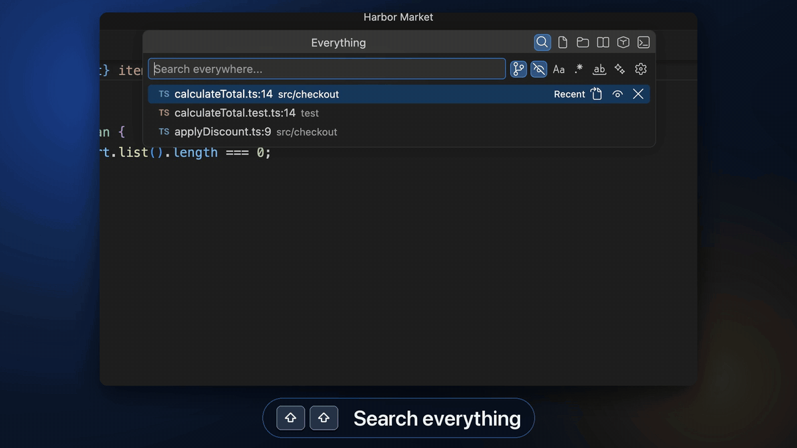

<p align="center">
  
</p>

<p align="center">
  <b>Search everything in VS Code from one popup.</b><br>
  Press <kbd>Shift</kbd> <kbd>Shift</kbd> to find files, folders, text, symbols, usages, and commands.<br>
  Inspired by Search Everywhere in JetBrains IDEs.
</p>

<p align="center">
  <a href="https://marketplace.visualstudio.com/items?itemName=expiracy.search-plus-plus"></a>
  <a href="https://marketplace.visualstudio.com/items?itemName=expiracy.search-plus-plus"></a>
  <a href="https://marketplace.visualstudio.com/items?itemName=expiracy.search-plus-plus&ssr=false#review-details"></a>
  <a href="https://ko-fi.com/expiracy"></a>
</p>

<p align="center">
  
  <br>
  <sub><a href="https://expiracy.github.io/search-plus-plus/">Watch the full captioned walkthrough</a></sub>
</p>

## Getting Started

Install from the
[VS Code Marketplace](https://marketplace.visualstudio.com/items?itemName=expiracy.search-plus-plus)
(VS Code 1.109+), press **Shift+Shift**, and type. Press **Tab** to switch mode;
your query comes with you.

| Mode | Searches |
|------|----------|
| **Everything** | The best matches from every other mode, in groups |
| **Files** | File names and paths |
| **Folders** | Folders with searchable files; opening one reveals it in the Explorer |
| **Text** | File contents, including notebook cells, with [ripgrep](https://github.com/BurntSushi/ripgrep) |
| **Symbols** | Functions, classes, and variables from your language extensions |
| **Commands** | VS Code commands, built in and from extensions |

<p align="center">
  
</p>

## Features

- **Recent history:** with the box empty, your last 20 files and locations in
  this workspace appear; **×** removes one. Turn on `rememberLastSearch` to
  reopen with your last query instead.
- **Preview:** press **Right Arrow** at the end of your query, or click a row's
  eye button, to show the result in one reusable editor tab while the popup
  keeps focus.
- **Find usages:** select a symbol and press **Cmd+Return** (**Ctrl+Enter**) or
  click its Find Usages button. Type to filter the references; **Back**
  restores your search. In an editor, **Find Usages** in the right-click menu
  works on the word at the cursor.
- **Go to line:** on Files or Everything, type `calculateTotal.ts:14` or
  `calculateTotal.ts:14:5`. **search++: Autofill File Path** fills in the
  selected file's path, ready for a line number.
- **Absolute paths:** type a full path to open a file or folder, even outside
  the workspace.
- **Search options:** toggle case sensitivity, regex, whole word, and fuzzy
  matching in the popup.
- **Ignore files:** `.gitignore`, [`.searchignore`](#searchignore), and
  `excludedPaths` keep noise out. The popup's toggles switch the ignore files
  off temporarily.
- **Your layout:** reorder or hide tabs, pick the starting tab, and add keys
  that open a mode directly with a [shortcut preset](#keyboard-shortcuts).
- **File index:** the status bar item shows indexing progress and the file
  count; click it to reindex.

<p align="center">
  
</p>

### `.searchignore`

Hide files from search++ without touching `.gitignore`. A `.searchignore` uses
the same syntax, can sit in any folder, and applies as soon as you save it:

```
# Generated docs and fixtures
docs/api/
test/fixtures/**/*.json
```

**Option+S** (**Alt+S**) shows the hidden files again for the current session;
`searchIgnoreRules` sets the default.

## Keyboard Shortcuts

| macOS | Windows / Linux | Action |
|-------|-----------------|--------|
| **Shift+Shift** | **Shift+Shift** | Open search |
| **Tab** | **Tab** | Next mode |
| **Return** | **Enter** | Open at the matched line |
| **Right Arrow** (at query end) or **Cmd+Right** | **Right Arrow** (at query end) or **Ctrl+Right** | Preview |
| **Cmd+Return** or **Shift+F12** | **Ctrl+Enter** or **Shift+F12** | Find usages |
| **Option+C** / **R** / **W** / **F** | **Alt+C** / **R** / **W** / **F** | Toggle case, regex, whole word, fuzzy |
| **Option+G** / **S** | **Alt+G** / **S** | Toggle `.gitignore` / `.searchignore` filtering |

`searchPlusPlus.shortcutPreset` adds keys that open a mode directly:

| Mode | `vscode` preset | `intellij` preset |
|------|-----------------|-------------------|
| Files | Cmd/Ctrl+P | Cmd+Shift+O / Ctrl+Shift+N |
| Symbols | Cmd/Ctrl+T | Cmd+O / Ctrl+N |
| Text | Cmd/Ctrl+Shift+F | Cmd/Ctrl+Shift+F |
| Commands | Cmd/Ctrl+Shift+P | Cmd/Ctrl+Shift+A |

For custom keybindings, the `when` context keys are `searchPlusPlusModalOpen`,
`searchPlusPlusFileTab`, `searchPlusPlusEverythingTab`,
`searchPlusPlusSymbolTab`, and `searchPlusPlusSymbolSelected`.

## Settings

Click the popup's cog to open search++ settings.

| Setting | Default | Description |
|---------|---------|-------------|
| `whenSearchOpens` | `everywhere` | Starting tab, or `last` |
| `rememberLastSearch` | `false` | Reopen with the last query, tab, and selection (this session only) |
| `tabOrder` | All modes | Tab and Everything group order |
| `everythingTabSources` | All on | Modes shown as tabs and Everything groups |
| `showEverythingTab` | `true` | Show the Everything tab |
| `shortcutPreset` | `none` | `none`, `vscode`, or `intellij` |
| `resultsPerSearchType` | `200` | Results per mode |
| `resultsPerEverythingGroup` | `20` | Results per Everything group |
| `searchDelay` | `300` | Typing delay (ms) for Text, Symbols, and Commands |
| `gitIgnoreRules` / `searchIgnoreRules` | `true` | Respect `.gitignore` / `.searchignore` |
| `excludedPaths` | `[]` | Globs to always hide, such as `**/dist/**` |

All settings are under `searchPlusPlus.`. Settings from older versions are
migrated automatically.

## Limitations

- Symbols and usages are only as good as your language extensions.
- Text search doesn't work in virtual workspaces; remote workspaces are fine.
- Commands without a declared title, including many of VS Code's own, show
  their ID.

## Contributing

Issues and pull requests are welcome on
[GitHub](https://github.com/expiracy/search-plus-plus). See
[CONTRIBUTING.md](CONTRIBUTING.md), [ARCHITECTURE.md](ARCHITECTURE.md), and the
[changelog](CHANGELOG.md).
