<p align="center">
  
</p>

<p align="center">
  <b>Search everything in VS Code from one popup.</b><br>
  Press <kbd>Shift</kbd> <kbd>Shift</kbd> to find files, folders, text, symbols, usages, and commands.<br>
  Inspired by Search Everywhere in JetBrains IDEs.
</p>

<p align="center">
  <a href="https://marketplace.visualstudio.com/items?itemName=expiracy.search-plus-plus"></a>
  <a href="https://marketplace.visualstudio.com/items?itemName=expiracy.search-plus-plus"></a>
  <a href="https://marketplace.visualstudio.com/items?itemName=expiracy.search-plus-plus&ssr=false#review-details"></a>
</p>

<p align="center">
  <a href="https://marketplace.visualstudio.com/items?itemName=expiracy.search-plus-plus">Install</a> ·
  <a href="#seven-search-modes">Search modes</a> ·
  <a href="#keyboard-shortcuts">Shortcuts</a> ·
  <a href="#settings">Settings</a> ·
  <a href="CHANGELOG.md">Changelog</a>
</p>

<p align="center">
  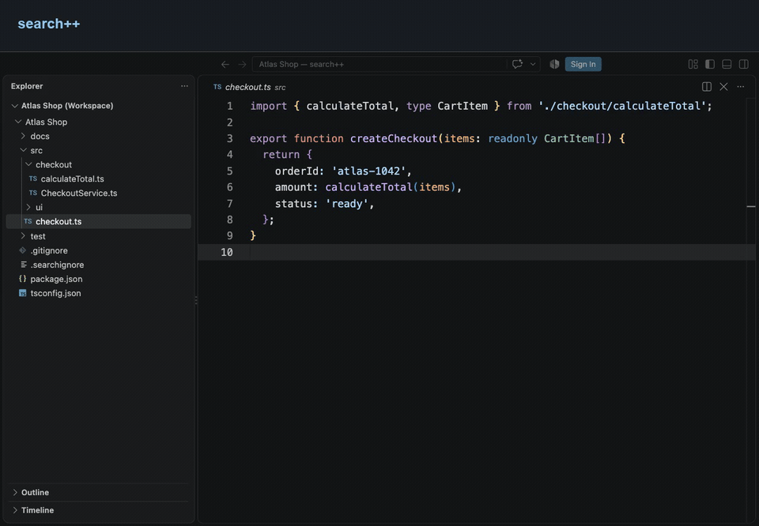
</p>

## Why search++

- **One shortcut for every search.** Files, folders, text, symbols, usages, and
  commands share one popup. Press **Tab** to change mode without losing your query.
- **Everything at a glance.** The Everything tab groups the best matches from each
  source, so you can find a file, a line of text, or a command from one place.
- **Browse results without leaving the popup.** Press **Right Arrow** to preview a
  result in a reusable editor tab. The matched line is centered, and the popup keeps focus.
- **Find usages in the same popup.** Pick a symbol and press **Shift+F12** to list
  its references. Type over the name to filter them by text or path.
- **Fast on large workspaces.** File search uses an in-memory index with fzf
  matching, and text search streams results from ripgrep.
- **Respects your ignore files.** `.gitignore`, `.searchignore`, and custom
  exclusion globs keep generated and vendored files out of your results.

## Getting Started

1. Install **search++** from the
   [VS Code Marketplace](https://marketplace.visualstudio.com/items?itemName=expiracy.search-plus-plus),
   or run `code --install-extension expiracy.search-plus-plus`.
2. Press **Shift+Shift** to open the search popup.
3. Start typing. All seven mode icons stay visible; click one or press **Tab** to
   cycle between search modes.

search++ requires VS Code 1.96 or a newer compatible release. See the
[changelog](CHANGELOG.md) for release notes and upgrade changes.

## Seven Search Modes

| Mode | What it searches |
|------|------------------|
| **Everything** | Files, folders, text, symbols, and commands in grouped sections |
| **Files** | File names and paths across your workspace |
| **Folders** | Folders containing searchable files |
| **Text** | File contents (powered by ripgrep) |
| **Symbols** | Functions, classes, variables via VS Code's language providers |
| **Usages** | Find a symbol, then list its semantic references |
| **Commands** | All VS Code commands (built-in and from extensions) |

<p align="center">
  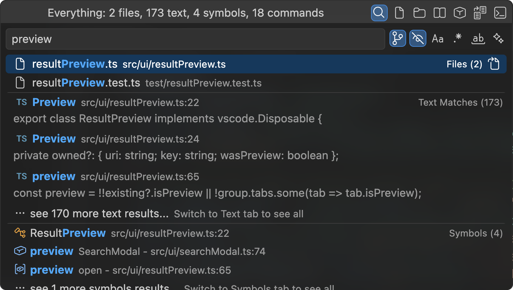
  <br><em>Everything: grouped results from every source</em>
</p>

| 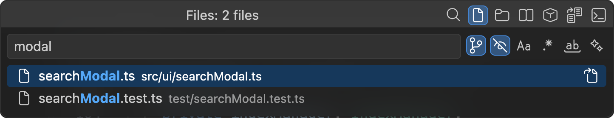 | 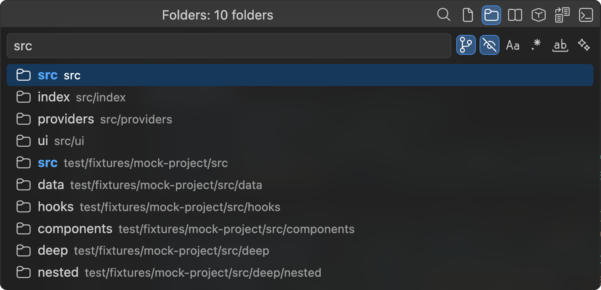 |
|:---:|:---:|
| **Files**: fuzzy path matching | **Folders**: reveal a folder in the Explorer |
| 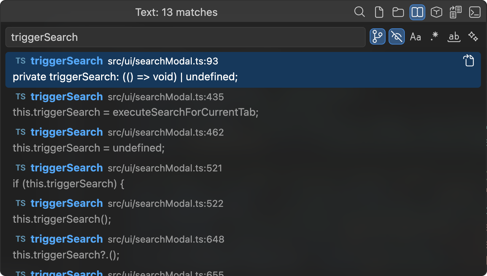 | 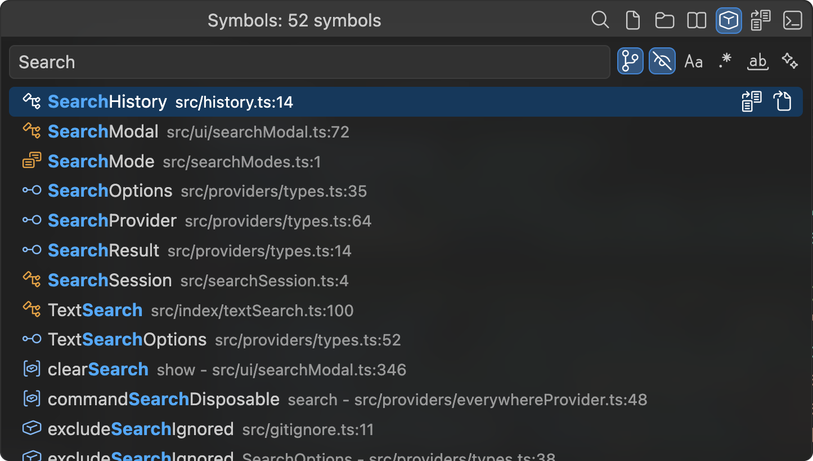 |
| **Text**: ripgrep matches with line previews | **Symbols**: from your language servers |
| 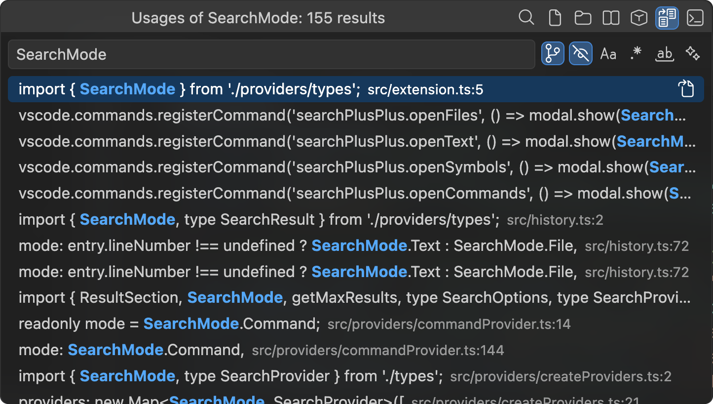 | 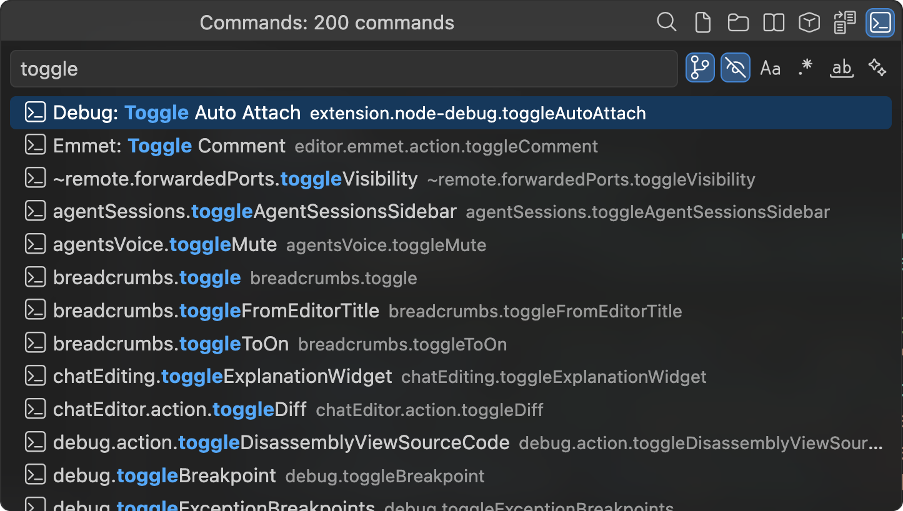 |
| **Usages**: semantic references to a symbol | **Commands**: every VS Code command |

## Features

### Find Usages

Open **Usages**, type a symbol name, select the matching symbol, and press
**Enter** to list its references. You can also select a symbol in **Symbols** or
**Everything**, then press **Shift+F12** or click its **Find Usages** button.

<p align="center">
  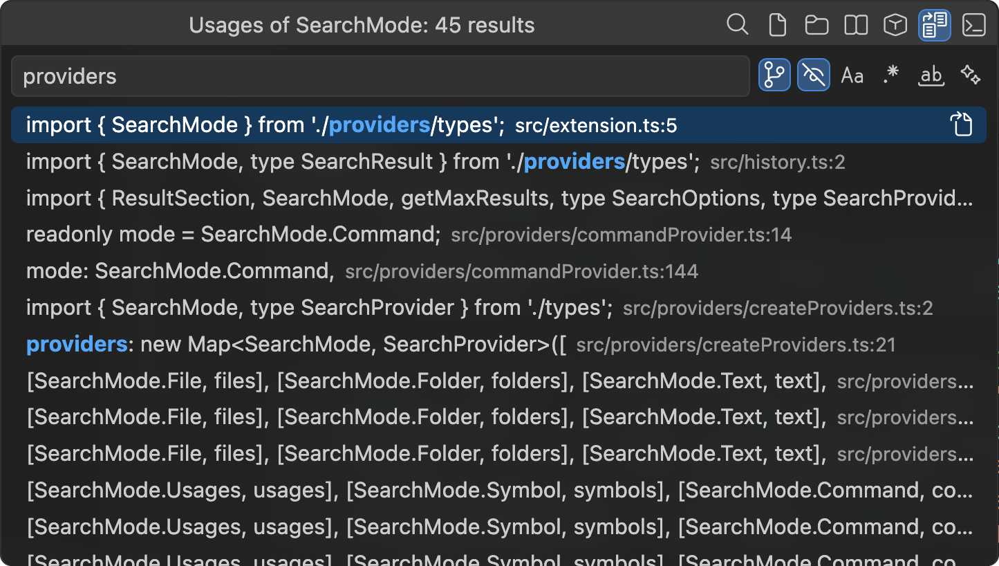
  <br><em>Type over the symbol name to filter its references</em>
</p>

The popup shows the selected symbol in its title and search box. This is one
level deeper than choosing a symbol. **Clear the search box** to leave that lookup
and search for another symbol. Clearing also removes a cached usage lookup when
you switch modes.

To filter the current references, replace the symbol name directly with text or
a filename. Select a result to jump to that exact reference. Clicking the
**Usages** mode icon again returns to the original symbol query; returning to
**Symbols** also restores that query.

From an editor, use **search++: Find Usages** in the command palette or context
menu to find references to the symbol at the cursor. Without an editor symbol,
the command opens the symbol chooser.

References come from VS Code's language providers. Coverage depends on installed
language extensions and their indexing state; some language services start when
you open a source file. Declarations appear when the provider includes them.
Empty reference lists, unmatched filters, and language-provider failures have
separate messages. Git-ignore, search-ignore, and custom exclusions also apply to
references.

### Preview a Result

Press **Right Arrow** on a file, text, symbol, or usage result to preview its file
while the popup keeps focus. Text matches jump to their line and column, with the
matched line centered in the editor where scrolling permits. Use the arrow keys
to select another result and **Right Arrow** to preview it in the same additional
editor tab, including when VS Code's preview tabs are disabled.
Existing tabs are reused. Files you edit, pin, or keep open are preserved.
Press **Enter** to open the selected result normally. Folders, commands, and
informational rows have no file preview.

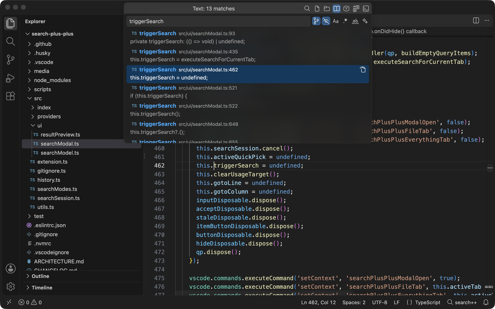

### Go to Line and Column

On the **Files** or **Everything** tab, append `:line` or `:line:column` to jump to
a specific location. Line and column numbers start at 1:

```
searchModal.ts:42
searchModal.ts:42:5
```

Press **Ctrl+Enter** to autofill the selected file's path, then type the line and
optional column after the inserted colon. The file remains searchable while you
type a column, such as `file.ts:42:`. Only numeric line and column suffixes are
interpreted as navigation.

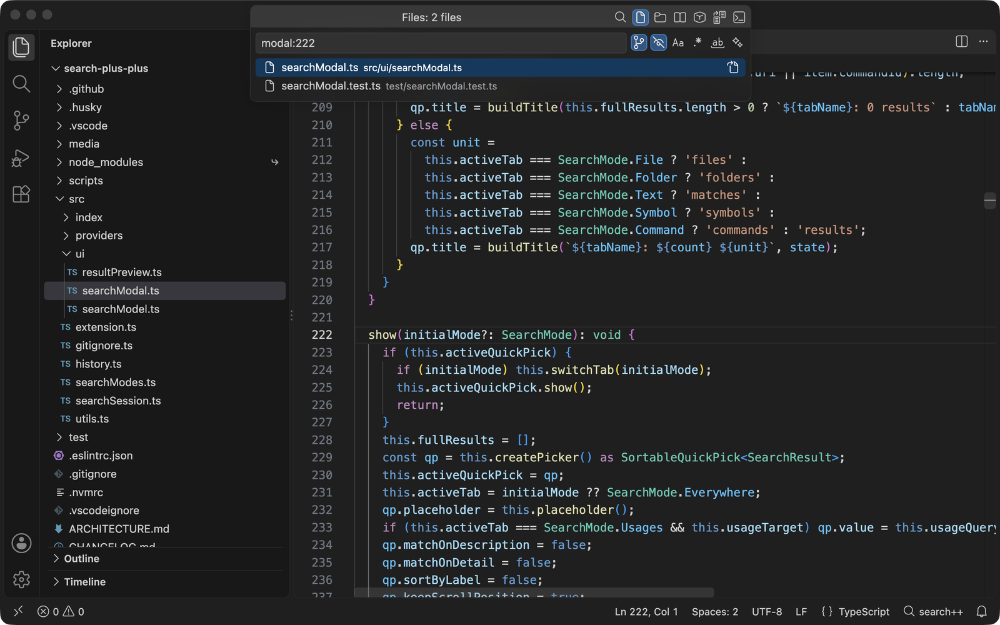

### Go to File

Click the **Go to File** button on a file, text, symbol, usage, or recent-history
row to open its file in the current editor group. Matches retain their line and
column, including a location typed as `file:line:column`. Confirmed opens are
added to recent history.

### Search Options

Toggle these while the search popup is open:

| Toggle | Shortcut | Description |
|--------|----------|-------------|
| Case Sensitive | **Alt+C** | Match exact case |
| Regex | **Alt+R** | Use regular expressions for text search |
| Match Whole Word | **Alt+W** | Only match complete words |
| Fuzzy Search | **Alt+F** | Use fuzzy matching for paths, commands, and symbol candidates |
| Exclude Git Ignored | **Alt+G** | Hide files excluded by `.gitignore` |
| Exclude Search Ignored | **Alt+S** | Hide files excluded by `.searchignore` |

Regex applies to text search. Fuzzy matching applies to files, folders, commands,
symbols, and usage previews; text search uses literal text or a regular
expression. Match Whole Word uses literal matching for files, folders, commands,
and usage previews, and filters symbol names returned by the language provider.

### Absolute Path Support

On the **Files**, **Folders**, or **Everything** tab, enter a full filesystem path
such as `C:\Users\me\file.ts` or `/home/me/file.ts`. Select the result to open the
file or reveal the folder in the Explorer.

### Search History

Recently opened files and locations appear when the search input is empty,
except in Usages mode. History is stored per workspace. Use the remove button to delete an entry;
deleted-file entries are pruned in the background when another file is added to
history.

### Notebook Support

Text search includes cell source in Jupyter `.ipynb` notebooks. Selecting a match
opens the notebook. Navigation to the exact matching cell is unsupported.

## Search Coverage

search++ requires VS Code 1.96 or a newer compatible release. Folder search shows
folders containing files included by the current filters; empty directories do
not appear. Symbol and usage results depend on installed language extensions and their
indexing state.

Text search requires a filesystem workspace and a ripgrep executable on the
extension host. Filesystem workspaces can be searched on a remote extension host
when ripgrep is available there. Text search in virtual workspaces is unsupported.

## Keyboard Shortcuts

| Shortcut | Action | Context |
|----------|--------|---------|
| **Shift+Shift** | Open search (Everything tab) | Global |
| **Tab** | Next search mode | Popup open |
| **Right Arrow** | Preview the selected file in one reusable tab | Popup open |
| **Shift+F12** | Find usages of the selected symbol | Popup open |
| **Alt+C** | Toggle case sensitive | Popup open |
| **Alt+R** | Toggle regex | Popup open |
| **Alt+W** | Toggle match whole word | Popup open |
| **Alt+F** | Toggle fuzzy search | Popup open |
| **Alt+G** | Toggle exclude git ignored | Popup open |
| **Alt+S** | Toggle exclude search ignored | Popup open |
| **Ctrl+Enter** | Autofill file path | Files or Everything tab |

Keymap extensions can claim the same shortcuts. If **Shift+F12** performs another
action, add this override to **Preferences: Open Keyboard Shortcuts (JSON)**:

```json
{
  "key": "shift+f12",
  "command": "searchPlusPlus.findUsages",
  "when": "searchPlusPlusModalOpen"
}
```

The rule applies while the popup is open. See VS Code's
[keyboard shortcut rules](https://code.visualstudio.com/docs/configure/keybindings#_keyboard-rules)
for how user overrides take precedence.

## Commands

These commands are available from the command palette (`Ctrl+Shift+P` / `Cmd+Shift+P`):

**Search**

| Command | Description |
|---------|-------------|
| `search++: Open Search` | Open the search popup (Everything tab) |
| `search++: Search Files` | Open directly to the Files tab |
| `search++: Search Text` | Open directly to the Text tab |
| `search++: Search Symbols` | Open directly to the Symbols tab |
| `search++: Search Commands` | Open directly to the Commands tab |
| `search++: Find Usages` | Find references to a selected symbol or the symbol at the editor cursor |
| `search++: Reindex Workspace` | Rebuild the file index |

**Toggles and Navigation**

These are also callable from the command palette and can be used in custom keybindings:

| Command | Description |
|---------|-------------|
| `search++: Toggle Case Sensitive` | Toggle case-sensitive matching |
| `search++: Toggle Regex` | Toggle regular expression matching |
| `search++: Toggle Only Git Trackable` | Toggle git-ignored file exclusion |
| `search++: Toggle Exclude Search Ignored` | Toggle `.searchignore` file exclusion |
| `search++: Toggle Fuzzy Search` | Toggle fuzzy matching |
| `search++: Toggle Match Whole Word` | Toggle whole-word matching |
| `search++: Next Tab` | Switch to the next tab |
| `search++: Previous Tab` | Switch to the previous tab |
| `search++: Preview Selected Result` | Preview the active result while keeping search focused |
| `search++: Autofill File Path` | Autofill the selected file's path |

## Settings

All settings are under the `searchPlusPlus` namespace.

| Setting | Default | Description |
|---------|---------|-------------|
| `searchPlusPlus.excludeGitIgnored` | `true` | Exclude git-ignored files by default |
| `searchPlusPlus.excludeSearchIgnored` | `true` | Exclude files matching `.searchignore` patterns by default |
| `searchPlusPlus.excludePaths` | `[]` | Glob patterns to always exclude (e.g. `**/dist/**`, `**/*.min.js`) |
| `searchPlusPlus.maxResults` | `200` | Maximum results per search mode |
| `searchPlusPlus.debounceMs` | `300` | Delay in ms before debounced text, symbol, usage, and command searches |
| `searchPlusPlus.everywhere.sections` | `["files", "folders", "text", "symbols", "commands"]` | Sections shown on the Everything tab; array order controls display order |
| `searchPlusPlus.everywhere.resultLimit` | `20` | Maximum results per section on the Everything tab (1-200) |

### `.searchignore`

Create a `.searchignore` file in your workspace to exclude files and folders from search results without modifying `.gitignore`. The file uses identical syntax to `.gitignore`.

```
# Hide generated docs from search
docs/
*.pdf

# Hide large data files
data/**
*.csv
```

Nested `.searchignore` files are supported. Patterns are scoped to the directory
containing the file, just like `.gitignore`. Changes reload the rules and rebuild
the index automatically; a manual reindex is unnecessary.

Toggle this filter on or off with **Alt+S** while the search popup is open.

### How Exclusions Layer

Exclusions are applied additively from three sources:

1. **Git ignored** -- `.gitignore` rules (toggled with **Alt+G**)
2. **Search ignored** -- `.searchignore` rules (toggled with **Alt+S**)
3. **Custom patterns** -- `searchPlusPlus.excludePaths` (always applied)

Rules apply within each workspace root. Git's internal metadata is excluded from
workspace indexing and text searches, including when both toggles are off.

## Status Bar

The status bar shows the current state of the file index. Click it at any time to trigger a manual reindex.

| State | Icon | Meaning |
|-------|------|---------|
| Building | Spinner | A workspace snapshot is being built; the previous snapshot remains usable during rebuilds |
| Ready | Search | Index is ready; tooltip shows the file count |
| Stale | Warning | Bulk or directory changes detected; an automatic rescan is scheduled |
| Error | Error | Index build failed |

## Custom Keybindings

The extension sets context keys you can use in custom `keybindings.json` `when` clauses:

| Context Key | When it is `true` |
|-------------|-------------------|
| `searchPlusPlusModalOpen` | The search popup is open |
| `searchPlusPlusFileTab` | The Files tab or Everything tab is active |
| `searchPlusPlusEverythingTab` | The Everything tab is active |

Example:

```json
{
  "key": "ctrl+shift+f",
  "command": "searchPlusPlus.openText",
  "when": "!searchPlusPlusModalOpen"
}
```

## How It Works

- **File and folder search** uses an in-memory index built on activation, kept up to date by a file system watcher. Fuzzy matching is powered by [fzf](https://github.com/junegunn/fzf).
- **Text search** spawns [ripgrep](https://github.com/BurntSushi/ripgrep) with streaming JSON output for fast content search.
- **Symbol search** delegates to VS Code's workspace symbol providers, so results depend on your installed language extensions.
- **Usages** resolve semantic references for a selected symbol through VS Code’s language providers.
- **Command search** indexes all registered VS Code commands (built-in and from extensions).

See the [architecture documentation](ARCHITECTURE.md) for component responsibilities,
request flow, indexing, and backend behavior.

## Contributing

Bug reports and pull requests are welcome on
[GitHub](https://github.com/expiracy/search-plus-plus). See the
[contributing guide](CONTRIBUTING.md) for local development, validation, and
Marketplace releases.
